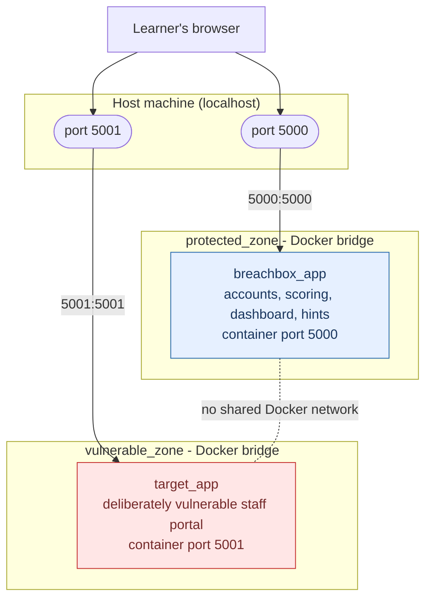

# Network topology

The two-zone isolation model as a picture. This is the same setup the
[Week 8 isolation test](week8_isolation_test.md) and the automated
`scripts/isolation_test.py` check.

There are two Docker bridge networks, `protected_zone` and
`vulnerable_zone`, with **no network joining them**. Each app is published
to the host on its own port, so a learner reaches both from their browser.
The two containers are not meant to reach each other; how strictly that is
enforced depends on the host (see below).

The dashed line is **not** a connection, it marks the gap: there is
deliberately no Docker network between the two zones. `docker-compose.yml`
puts `breachbox_app` only on `protected_zone` and `target_app` only on
`vulnerable_zone`, and lists no network they share.

Name-based attempts to connect from one zone to the other fail: neither
container can resolve the other. Whether a raw-IP attempt also fails depends
on the host. A native Linux Docker host isolates separate networks by
default, so the path is blocked; Docker Desktop for Windows does not enforce
that, so `scripts/isolation_test.py` reports the IP path as reachable there.
For the live event the two zones should run on a Linux host or on separate
machines, where the separation holds.

## The one intended crossing

A student exploits `target_app`, recovers a flag string, and then manually
submits that string to `breachbox_app` at `/api/submit`. That human step is
the only designed path between the zones, and it carries a short piece of
text, not a network connection. Everything else is blocked by design.
